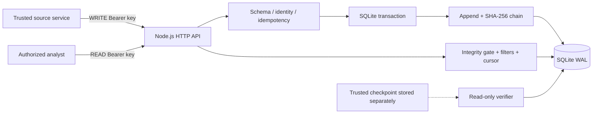

# Audit Trail API

**An append-only SQLite audit event service with scoped API keys, idempotent ingestion, keyset pagination, and verifiable SHA-256 hash chaining.**


> **Portfolio reference implementation.** Designed to demonstrate careful API contracts, secure input boundaries, SQL transactions, append-only data, idempotency and testable engineering decisions. Not a regulatory-compliant or tamper-proof audit archive.

## Why build it?

Applications need a defensible record of security-sensitive business activity (authentication outcomes, permission changes, configuration changes, order actions). A basic CRUD table allows accidental mutation, ambiguous authorship and hard-to-paginate searches. This service deliberately exposes **create + read only**, stores an immutable sequence via SQLite triggers and links each row to the previous row by a deterministic hash.

The source service must be trusted: it **asserts** the `actorId` and optional `occurredAt`. The server derives the `serviceId`, event ID, server recording time and integrity fields. The hash chain detects inconsistent changes but does **not** defeat a privileged administrator who can rewrite the database and regenerate hashes.

## Highlights

- **Append-only events:** `POST`, `GET`, no public update/delete routes; SQLite triggers reject ordinary update/delete statements.
- **Separated read/write credentials:** constant-time SHA-256 digest comparison, server-derived service identity.
- **Optional idempotency:** repeated `(serviceId, Idempotency-Key)` + identical request returns the original event; changed payload returns HTTP 409.
- **Tamper-evident SHA-256 chain:** startup checks existing records, and API reads/writes fail closed when SQLite reports any unexpected change by another database connection. A separately trusted checkpoint can detect historical truncation/rewrite after restart.
- **SQLite transactions:** serialized writers using `BEGIN IMMEDIATE`, WAL mode and `synchronous=FULL` for local durable storage.
- **Fast practical queries:** strict field filters, indexes and descending sequence keyset pagination (`limit` 1–100).
- **Strict request parsing:** reject invalid UTF-8 and duplicate JSON object keys (including escaped equivalent keys), bound JSON size, metadata nesting and value count; no client-supplied hash/sequence/service ID.
- **Operational tools:** checked, safely published SQLite online backups; offline integrity verification; exportable checkpoints; health checks; graceful shutdown; configured record-capacity limit and CI tests.
- **Zero external runtime dependencies:** built with Node.js core modules, native `node:sqlite` and `node:test`.

## Technology and prerequisites

- **Node.js 24.22.3 LTS or a newer security-patched 24.x release recommended.** `node:sqlite` is a release-candidate API on Node 24.15+. Node 22.13+ can run the project but still marks SQLite as experimental; automated tests were additionally executed using Node 22.16.0.
- SQLite included in Node.js (`node:sqlite`); no separate SQLite installation or npm packages required.
- Git and an optional Docker installation.

## Architecture



Full design rationale: [Architecture](docs/ARCHITECTURE.md), [Security](docs/SECURITY.md), [OpenAPI 3.1 contract](docs/openapi.yaml), [ADR-0001](docs/adr/0001-dependency-free-http-sqlite.md), [Verification report (FA)](docs/verification/FINAL-REPORT-FA.md).

## Quick start

```bash
# 1. Clone and enter the repository
# git clone https://github.com/<YOUR_USERNAME>/audit-trail-api.git
cd audit-trail-api

# 2. Create local config (never commit .env)
cp .env.example .env

# 3. Generate two different secure keys (repeat twice)
node -e "console.log(require('node:crypto').randomBytes(32).toString('base64url'))"
# Put each generated value in AUDIT_WRITE_KEY and AUDIT_READ_KEY in .env.

# 4. Start server, using Node's native env file support
node --env-file=.env src/server.js
```

Windows PowerShell instructions: [SETUP-FA.md](SETUP-FA.md).

By default the service listens on `127.0.0.1:3000`. Public deployment requires a TLS-terminating reverse proxy and additional network restrictions. Never send Bearer tokens over unencrypted public HTTP.

### Environment variables

| Variable | Default | Description |
|---|---|---|
| `AUDIT_WRITE_KEY` | **Required** | Random base64url key representing at least 32 decoded bytes |
| `AUDIT_READ_KEY` | **Required** | Different random base64url key with read-only scope |
| `AUDIT_WRITE_SERVICE` | `demo-api` | Trusted source-service ID, lower-case `[a-z0-9_-]` (2–64 chars) |
| `AUDIT_DB_PATH` | `./data/audit.sqlite` | SQLite file path, or `:memory:` for tests |
| `AUDIT_HOST` | `127.0.0.1` | `127.0.0.1`, `0.0.0.0` or `::1` |
| `AUDIT_PORT` | `3000` | TCP port 1–65535 |
| `AUDIT_MAX_EVENTS` | `100000` | Maximum accepted sequence in this database (1–1,000,000); append returns 507 when reached |
| `AUDIT_TRUSTED_CHECKPOINT_PATH` | Unset | Optional path to a previously exported **independently trusted**, read-only checkpoint; startup checks the stored prefix against it |

## HTTP API

| Method | Path | Scope | Description |
|---|---|---|---|
| `GET` | `/health/live` | Public | Liveness check |
| `GET` | `/health/ready` | Public | Integrity, database access **and capacity for new events**; returns 503 when ingest is full |
| `POST` | `/v1/events` | WRITE | Append new audit event |
| `GET` | `/v1/events` | READ | Filtered, cursor-paginated list |
| `GET` | `/v1/events/{uuid}` | READ | Read single event |
| `PATCH/PUT/DELETE` | `/v1/events...` | None | Not supported; HTTP 405 |

### Create event

```bash
curl -i -X POST http://127.0.0.1:3000/v1/events \
  -H "Authorization: Bearer YOUR_WRITE_KEY" \
  -H 'Content-Type: application/json' \
  -H 'Idempotency-Key: signup-event-001' \
  -d '{"eventType":"auth.login","actorId":"user_42","outcome":"success","resourceType":"session","resourceId":"session_99","metadata":{"method":"passkey"}}'
```

**Request body** (`application/json`, optional UTF-8 charset including quoted form; max 12 KiB, strict UTF-8 decoding, duplicate JSON keys rejected at every level):

```json
{
  "eventType": "auth.login",
  "actorId": "user_42",
  "outcome": "success",
  "resourceType": "session",
  "resourceId": "session_99",
  "metadata": { "method": "passkey" },
  "occurredAt": "2026-11-21T11:25:00.000Z"
}
```

| Field | Rules |
|---|---|
| `eventType` | Required, max 80, lower-case dotted/dashed/underscored identifier |
| `actorId` | Required, max 128, stable caller-provided identifier (not independently authenticated user identity) |
| `outcome` | Required: `success`, `failure` or `denied` |
| `resourceType` / `resourceId` | Optional together; identifies an affected object |
| `metadata` | Optional object (default `{}`); max 4096 UTF-8 bytes; avoid secrets and PII. JSON numeric tokens must round-trip without changing their mathematical decimal value and have magnitude at most `Number.MAX_SAFE_INTEGER`; large IDs and exact decimal/money values **must be strings**. IEEE-754 floating-point fractions are not lossless decimal representations. |
| `occurredAt` | Optional RFC3339 timestamp with timezone; no more than 5 minutes ahead of server time |

**Success `201 Created`:**

```json
{
  "data": {
    "sequence": 1,
    "id": "e23bf139-e63c-4420-b390-0406b1d27ffd",
    "serviceId": "demo-api",
    "eventType": "auth.login",
    "actorId": "user_42",
    "resourceType": "session",
    "resourceId": "session_99",
    "outcome": "success",
    "metadata": { "method": "passkey" },
    "occurredAt": "2026-11-21T11:25:00.000Z",
    "recordedAt": "2026-11-21T11:25:01.000Z",
    "idempotencyKey": "signup-event-001",
    "payloadDigest": "64-character-sha256-hex-value",
    "previousHash": "64-character-sha256-hex-value",
    "entryHash": "64-character-sha256-hex-value"
  }
}
```

The above is an *illustrative response shape*, not a captured runtime response. Server-generated values vary.

With the same valid `Idempotency-Key` and semantically identical request, the service returns **`200 OK`** with `Idempotent-Replayed: true` and exactly the same event. A changed payload with the same key returns `409 Conflict`. Without the optional key, each POST creates a new event.

### Search and paginate

```bash
curl -H "Authorization: Bearer YOUR_READ_KEY" \
  'http://127.0.0.1:3000/v1/events?eventType=auth.login&actorId=user_42&limit=20'
```

Supported query parameters: `eventType`, `actorId`, `resourceType`, `resourceId`, `outcome`, `from`, `to`, `limit`, `cursor`.

- `from` is inclusive, `to` is exclusive; both filter **server `recordedAt`**.
- `limit` defaults to 20, maximum 100.
- Each response contains `data: []` and `nextCursor: string | null`.
- To request the next page, pass `?cursor=<nextCursor>` *with the same filters*.
- Pagination is based on descending sequence numbers, not OFFSET.

### Errors

The service responds with `application/problem+json`:

```json
{
  "type": "about:blank",
  "title": "Bad Request",
  "status": 400,
  "detail": "Invalid outcome filter",
  "code": "validation_error",
  "requestId": "..."
}
```

| HTTP status | Meaning |
|---|---|
| 400 | Malformed request/schema/query |
| 401 | Missing, invalid or wrong-scope credential |
| 404 | No matching event / route |
| 405 | Unsupported write mutation method |
| 409 | Idempotency key previously used for different content |
| 413 | Exceeds request body limit |
| 415 | Wrong Content-Type |
| 500 | Unexpected internal error; details suppressed |
| 503 | Audit integrity is unavailable; reads/writes refused pending investigation |
| 507 | Configured event capacity or SQLite disk storage has been exhausted; new event is not persisted |

## Test and verification

```bash
npm ci                  # Reproducible install; zero third-party dependencies
npm test                # Unit + real HTTP integration tests
npm run test:coverage   # Built-in Node coverage measurement
npm run smoke           # Auto-started local server, write, read and verify
npm run e2e:disk        # Process restart, on-disk DB, backup, checkpoint verification
npm run check           # Syntax, tests and smoke
npm run benchmark       # Informational localhost/in-memory load measurement
```

**Offline chain verification** (read-only):

```bash
npm run verify -- --db ./data/audit.sqlite
```

**Trusted external checkpoints:** export a verified chain head, then copy the resulting JSON to immutable or independently controlled storage. Keeping the checkpoint next to the DB or granting the same operator write access to both defeats its threat-model purpose.

```bash
npm run checkpoint -- --db ./data/audit.sqlite --out ./backups/weekly.checkpoint.json
# Move/copy that JSON OFF-HOST to separately trusted storage.
# Later, using the trusted copy:
npm run verify -- --db ./data/audit.sqlite --checkpoint ./backups/weekly.checkpoint.json
```

You can optionally configure `AUDIT_TRUSTED_CHECKPOINT_PATH` at startup to refuse a database whose verified chain no longer contains the known checkpoint prefix. A checkpoint **does not prove the legitimacy of subsequent writes** and is not digitally signed by this tool; its trust is supplied by protected external storage.

**Checked, consistently snapshotted backup** (refuses corrupted chains and existing destinations; publishes only after validating the temporary backup):

```bash
npm run backup -- --db ./data/audit.sqlite --out ./backups/audit-backup.sqlite
npm run verify -- --db ./backups/audit-backup.sqlite
```

The benchmark uses an **in-memory** database and loopback requests; its results are diagnostic only, not a production performance guarantee. Configure `BENCHMARK_REQUESTS` (1–10000) and `BENCHMARK_CONCURRENCY` (1–50) if desired.

Do not rely on copying a live SQLite file while WAL is enabled. Keep backup copies and chain head checkpoints in secure, separate storage. A database administrator can regenerate all hashes; without an external checkpoint this is not a non-repudiation guarantee.

## Docker

```bash
docker build -t audit-trail-api .
docker volume create audit-trail-data
docker run --rm -p 127.0.0.1:3000:3000 \
  --env-file .env \
  -e AUDIT_HOST=0.0.0.0 \
  -e AUDIT_DB_PATH=/data/audit.sqlite \
  -v audit-trail-data:/data \
  audit-trail-api
```

**Why the explicit `-e` overrides?** The local `.env` intentionally sets `AUDIT_HOST=127.0.0.1` and `AUDIT_DB_PATH=./data/audit.sqlite`. Docker `--env-file` overrides Dockerfile `ENV`, so these two values must be overridden for container binding and persistent `/data` storage. The Docker CI job checks a write, container replacement, and read against the same volume. Docker execution is **not verified locally** unless you run it or the GitHub Actions Docker job passes.

## Operational notes and limitations

1. **Only one trusted writer identity** is configured per process. A production multi-service setup needs a credential store and individual service identities.
2. **No user-level authentication:** the upstream service asserts `actorId`. Do not mistake this for cryptographic identity proof.
3. **Node's synchronous SQLite API blocks the event loop.** This is for low/moderate ingestion on a single persistent server, not horizontally scaled high-throughput event collection.
4. **No built-in TLS, distributed rate limiter, automated retention, compliance certification or managed secret rotation.** Enforce these at the infrastructure layer.
5. **Hash chains alone cannot stop a malicious DB administrator** or detect historical tail removal after restart without an independently trusted checkpoint. Runtime `PRAGMA data_version` detection is best-effort against external SQL changes, not a security boundary against a compromised host or same-process attacker.
6. Startup checks all historical hashes in O(number of events) time. Changes detected from another SQLite connection force an unavailable state until investigated and restarted. Startup verification still performs an O(N) chain check. The event ceiling is count-based, not an exact disk-byte quota. Archive and migrate deliberately; do not silently delete audit records.
7. JSON request bodies are rejected when ambiguous duplicate keys or malformed UTF-8 are detected. Treat metadata as sensitive operational information. Do not store passwords, access tokens, full customer profiles or unnecessary personal data.
8. Schema changes require real migrations; this project supports schema version 1 only, compares the exact SQL definitions of all owned schema objects against a reference created by the running SQLite version, and refuses unknown versions before DDL. Equivalent but textually different schema definitions may be rejected by design.
9. HTTPS, API gateway request limits, automated archiving and backup restore drills are still operational responsibilities; the application itself is not an enterprise WORM/SIEM product.

See [Deployment and operations](docs/DEPLOYMENT.md), [Changelog](CHANGELOG.md) and the [v1.2 verification report](docs/verification/V1.2.0-FINAL-FA.md) for observed results and remaining limitations. Older reports are retained as historical records.

## Repo navigation

```
src/                 Strict JSON parser, HTTP adapter, config, domain, SQLite store
scripts/             Checked online backup, checkpoint exporter, verifier, smoke and Docker CI tests
tests/               Unit tests and real HTTP API integration tests
docs/                Architecture, security, deployment, OpenAPI and ADR
.github/workflows/   Automated verification
SETUP-FA.md           Persian Windows / VS Code setup
```

## License

MIT — see [LICENSE](LICENSE). This is independently authored reference code. Attribution should reflect actual contributors.
