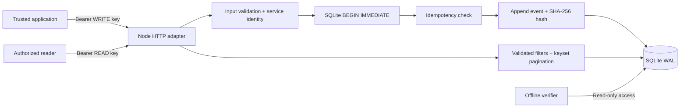

# Architecture and Engineering Decisions

## Context

An audit trail must record *who was asserted to have done what, when the source says it occurred, and when the collector persisted it*. It must also let an authorized reader search events without providing a mutation route. This implementation targets a **single trusted writer service**, an independent reader key and **one persistent SQLite database**. It is a portfolio reference architecture, not a compliance certification or distributed ledger.

## Modules

| Module | Responsibility |
|---|---|
| `src/config.js` | Environment validation and independent read/write credentials |
| `src/domain.js` | Pure event validation, canonical JSON, cursor/filter validation |
| `src/store.js` | SQLite schema version gate, transactions, hash chain, trusted-head checks, SQL query boundaries |
| `src/strict-json.js` | Detect duplicate JSON keys before `JSON.parse`; retain native syntax parsing |
| `src/checkpoint.js` | Validate independently trusted hash-chain checkpoints |
| `src/api.js` | HTTP routing, scopes, problem responses, body limits |
| `src/server.js` | Boot, liveness, operational shutdown |
| `scripts/verify-chain.js` | Read-only offline chain validation |
| `scripts/backup.js` | Source-verified, temp-file SQLite online backup, verified before exclusive publication |
| `scripts/checkpoint.js` | Export trusted chain prefix for off-host storage |

## Data model

`audit_events` has an AUTOINCREMENT sequence, immutable UUID, server-derived `service_id`, asserted `actor_id`, event type, resource identifiers, outcome, metadata JSON, source `occurred_at`, server `recorded_at`, optional idempotency key, payload SHA-256, predecessor hash and entry hash.

- `recorded_at` is generated by the server. Time filters use `recorded_at` (inclusive `from`, exclusive `to`).
- `occurred_at` is an **asserted** timestamp from the trusted writer; if absent, it equals `recorded_at`.
- `actor_id` is **asserted by the trusted upstream service**, not independently authenticated as the end user.
- `service_id` is bound to server configuration rather than accepted from the request.
- JSON metadata is limited to 4096 bytes and has bounded depth/element count; it is not intended for secrets or raw customer records.

## Write transaction and idempotency

For each request:

1. Authenticate the write scope before reading or parsing the body.
2. Validate the schema and canonicalize the normalized request.
3. `BEGIN IMMEDIATE` obtains SQLite's exclusive writer reservation.
4. Look up `(service_id, idempotency_key)`. Same payload hash returns original event (`200`); mismatched payload returns `409` without an insertion.
5. Get current chain head; compute next sequence and UUID.
6. Compute `sha256("audit-trail:v1\\n" + canonicalJson(entryFields))` including the preceding entry hash.
7. Insert once; database UPDATE/DELETE triggers make ordinary SQL mutation fail.
8. Commit atomically. Any error rolls back the transaction.

This prevents concurrent writers from creating diverging heads when SQLite locking works correctly. It does **not** make writes atomic across unrelated databases or remote services. The originating service should use its own durable outbox if it needs guaranteed delivery.

## Read path

All user-provided fields use parameterized queries. Filter column names are chosen from a static whitelist. Results use descending sequence-based *keyset pagination* (`cursor = previous page's final sequence`), with maximum `limit=100`. Concurrent new events do not shift the next page as happens with OFFSET pagination.

## Immutability versus tamper evidence

The public HTTP API has no update or delete endpoints. SQLite triggers block ordinary UPDATE/DELETE statements. A SHA-256 hash chain detects inconsistent edits and missing intermediate entries. A verified chain head is kept in process memory; `PRAGMA data_version` signals changes from other SQLite connections. Because exactly one writer connection is supported, **any** unexpected change from an external SQLite connection latches a 503 unavailable state. Operators must investigate and restart from a trusted state. Read queries run in a SQLite transaction to preserve a consistent snapshot. **This is not tamper-proof against a database administrator**: an operator can drop triggers, edit rows, recompute hashes, replace the DB, or truncate the tail. To detect truncation or a rewritten history across restarts, periodically export a checkpoint containing `(sequence, entryHash)` and store it in a separately trusted system. This project exports an **unsigned** JSON checkpoint; its authenticity depends on the independent storage system. `npm run verify -- --checkpoint ...` checks a trusted prefix, and the optional `AUDIT_TRUSTED_CHECKPOINT_PATH` enforces it on startup. Backup and retention are operator responsibilities.

## Persistence and operations

- SQLite WAL enables simultaneous readers and a single serialized writer; one transaction is completed at a time.
- `synchronous=FULL` prioritizes durable commits over maximum throughput.
- `node:sqlite`'s synchronous calls block the Node event loop; this service deliberately favors small, single-instance installations, not high-volume distributed ingestion.
- Files are created under `./data` by default. On Unix, the DB is restricted to `0600`; administrators must also secure the parent directory and backup files.
- Back up using the SQLite backup API, not by copying a live `.sqlite` file without its WAL context.
- Database schema version is `PRAGMA user_version=1`. Unknown versions are rejected **before any schema DDL**; all owned schema SQL definitions are checked for exact equivalence against a reference initialized by the same runtime, not silently recreated for existing databases. Breaking changes require explicit migrations.
- An explicit `AUDIT_MAX_EVENTS` ceiling limits the accepted append sequence, but it does not enforce a precise disk-byte limit; archiving and available-disk monitoring remain operational needs.
- External DB mutation detection is best-effort and cannot secure data against full host control, same-process compromise or changes between trust checks. Startup and explicit offline verification perform O(N) chain scans; unexpected external writes trigger immediate fail-closed behavior.

## Deployment constraints

Do not expose a plain HTTP service carrying bearer tokens directly to the public Internet. Use HTTPS at a trusted ingress, restrict access through a firewall/private network, and configure request limits at the ingress. Key rotation currently requires a restart. One configured writer service is supported. SQLite's local file must live on reliable local storage; network filesystems may cause locking issues.

## Startup integrity gate

The server verifies the persisted chain (and optional trusted checkpoint) before accepting requests and refuses to start if an existing event hash or sequence is inconsistent. This adds O(number of events) startup work; it is intentional for a bounded single-instance portfolio implementation. Very large collections should use signed checkpoints or asynchronous monitoring with an explicit operational trade-off.

## Strict numeric metadata contract (v1.2)

Unsafe JSON numeric values are rejected **before** native `JSON.parse` can round them, using a decimal token fingerprint check: magnitude above `Number.MAX_SAFE_INTEGER`, non-finite overflow, numeric underflow to zero and negative zero. Callers must encode exact transaction identifiers and fixed-point financial values as JSON **strings**. Ordinary accepted decimals still use JavaScript binary floating-point; this API does not guarantee decimal numeric losslessness. Existing v1 event records are not rewritten.

## Readiness contract (v1.2)

Liveness answers if the process can serve HTTP. Readiness means trusted SQLite state **and the ability to append a new event**. It returns 503 when `maxEvents` is reached; existing GETs and safe idempotent retries can still succeed. An automated orchestrator restart cannot reclaim append-only capacity. Operators must archive/roll over deliberately; see deployment guidance.

## Schema integrity

At startup and offline verification, all explicit version-1 `sqlite_master` SQL definitions are compared with a fresh in-memory schema created by the same runtime. This rejects no-op triggers with matching names. It is intentionally strict: equivalent SQL reconstructed with different formatting can be rejected. DB administrators are outside the threat boundary.
